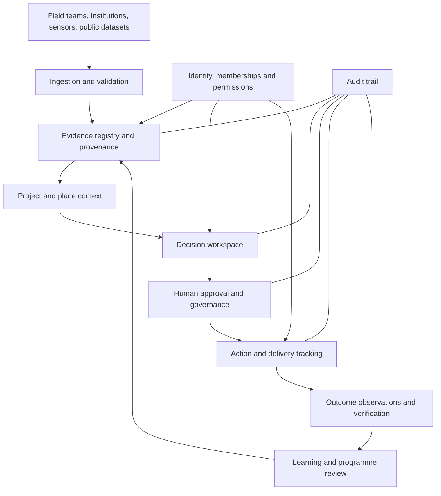

# Atlas Interoperability & Trust Layer
## Architecture proposal and staged implementation plan

**Status:** Proposed architecture RFC  
**Repository:** `ObiwanKenobee/atlas-sanctum-ym`  
**Decision:** Strengthen the existing Next.js + TypeScript + Supabase platform before introducing distributed-ledger or autonomous-agent infrastructure.

---

## 1. Executive decision

Atlas should become a trusted, multi-organization decision workspace for place-based programmes.

The first technical objective is not Web3, Web6 or Web7. It is to let two or more legitimate institutions collaborate on one project while preserving:

1. clear ownership and permissions;
2. traceable evidence and source provenance;
3. explicit separation of observation, inference, recommendation and decision;
4. an auditable record of who approved what and when;
5. measurable actions and outcomes.

The first release should support one real pilot and a small number of participating organizations. A broader interoperability network comes later.

**North-star workflow**

`PLACE → PROJECT → EVIDENCE → DECISION → ACTION → OUTCOME`

**Operating loop**

`OBSERVE → UNDERSTAND → DECIDE → COORDINATE → ACT → VERIFY → LEARN`

## 2. Current repository baseline

The following observations were verified in the repository during preparation of this RFC:

- The application uses Next.js, React, TypeScript and Supabase.
- `app/workspace/page.tsx` authenticates the user, loads workspace organizations, and loads portfolio observations for the first organization returned.
- `lib/organizations.ts` reads `organization_memberships` and related `organizations`, including a role value.
- `lib/portfolio.ts` reads `portfolio_observations` scoped by `organization_id`.
- The checked migrations create `workspace_profiles`, `field_records`, and the water-pilot tables.
- `workspace_profiles`, `field_records`, `water_service_points`, `water_incidents`, `water_actions`, and `water_outcomes` use user-scoped ownership and/or RLS policies based on `auth.uid() = user_id`.
- The checked water-pilot schema connects water incidents to service points, actions to incidents, and outcomes to actions.

### Important discovery gap

The repository code references `organizations`, `organization_memberships` and `portfolio_observations`, but a repository code search did not locate their table-creation migrations. Their definitions and current RLS policies must be inspected in the actual Supabase database and complete migration history before writing migrations that alter or depend on them.

**Do not run a guessed migration against production.** First establish the authoritative schema, existing constraints, grants, policies, indexes and deployment migration state.

## 3. Architecture principles

### 3.1 Tenant ownership first

- Organization-owned records carry an `organization_id`.
- Project-owned records carry a `project_id` and are constrained to the same organization as their project.
- Users receive access through explicit organization and, where appropriate, project memberships.
- A creator/submitter field is attribution, not an authorization mechanism.
- No cross-organization access is granted by knowing a UUID.

### 3.2 Evidence is not truth by default

Atlas must represent the difference between:

- **Observation:** what a person, sensor or source reports.
- **Source:** where the record came from and how it was collected.
- **Inference:** an interpretation derived from one or more records.
- **Prediction:** a model-generated estimate with method and uncertainty.
- **Recommendation:** a proposed course of action.
- **Decision:** an authorized human or institution's recorded choice.
- **Outcome:** what happened after an action, with a verification method.

Do not collapse these into a single generic `confidence` field.

### 3.3 Append history; do not silently rewrite it

Important decisions, approvals, evidence reviews and verification events should have an append-only history. Corrections should create a superseding version or correction event, retaining the earlier record and the reason for change.

This is an auditable workflow, not full event sourcing across the entire application.

### 3.4 Human authority remains explicit

An AI-generated summary or recommendation is not an approval. Agents may prepare evidence briefs, identify conflicts and propose next steps. A person with the required role must make consequential decisions.

### 3.5 Privacy and data minimization

- Keep personal, beneficiary and sensitive operational data off public ledgers.
- Store evidence files in private object storage with scoped access.
- Publish only approved, non-sensitive records.
- Design retention, consent, redaction and deletion rules before collecting beneficiary-level data.
- Do not treat a cryptographic hash as proof that the underlying claim is true.

## 4. Target logical architecture

Logical layers:

1. **Core platform:** authentication, organizations, projects, membership, APIs and storage.
2. **Evidence and knowledge:** sources, field observations, records, provenance and relationships.
3. **Decision operations:** briefs, alternatives, approvals, assigned actions and review history.
4. **Spatial context:** places, administrative boundaries, assets and geospatial references.
5. **Interoperability:** import/export contracts, partner APIs and later verifiable attestations.
6. **Intelligence assistance:** retrieval, contradiction detection, summaries and recommendations under human approval.
7. **Stewardship:** role authority, audit, appeals, data governance and oversight.

These are logical boundaries, not a mandate to deploy seven microservices. Keep the first implementation as a well-structured modular application and database.

## 5. Proposed domain model

The following is the target logical model. It is not a claim that all of these tables already exist.

| Entity | Purpose | Key relationship |
|---|---|---|
| organizations | Institutional tenant | One organization has many projects |
| organization_memberships | User's organizational role | User ↔ organization |
| projects | Time-bounded programme or intervention | Belongs to one organization |
| project_memberships | Project-specific participation and restrictions | User ↔ project |
| places | Reusable geographic entities | Projects and observations can reference places |
| project_places | Project's operating geography | Project ↔ place |
| evidence_records | Claim, observation or dataset reference | Belongs to project; cites source |
| evidence_sources | Origin, publisher, method and retrieval metadata | One source may support many records |
| evidence_relationships | Supports, contradicts, derives-from or supersedes | Evidence ↔ evidence |
| decision_records | Structured decision brief and current disposition | Belongs to project |
| decision_events | Proposed, reviewed, approved, rejected or superseded history | Belongs to decision |
| action_records | Approved work with owner, due date and status | Linked to decision/project |
| outcome_observations | Measured or reported result | Linked to project and, where applicable, action |
| audit_events | Security and accountability history | Scoped to tenant and actor |

### Minimum fields

**projects**
- `id`, `organization_id`, `name`, `slug`
- `purpose`, `domain`, `status`
- `created_by`, `created_at`, `updated_at`

**evidence_records**
- `id`, `organization_id`, `project_id`
- `evidence_type`, `claim_or_observation`
- `source_id`, `observed_at`, `collected_at`, `recorded_at`
- `method`, `limitations`, `quality_status`
- `location_id` or a controlled spatial reference
- `created_by`, `created_at`, `supersedes_id`

**evidence_sources**
- `id`, `organization_id` (nullable only for explicitly public shared sources)
- `publisher`, `source_name`, `source_uri`
- `source_type`, `retrieved_at`, `published_at`
- `collection_method`, `license`, `citation`

**decision_records**
- `id`, `organization_id`, `project_id`
- `title`, `problem_statement`, `options_considered`
- `evidence_snapshot` or versioned evidence links
- `recommendation`, `uncertainties`, `limitations`
- `status`, `proposed_by`, `decided_by`, `decided_at`

**decision_events**
- `id`, `decision_id`, `event_type`
- `actor_user_id`, `actor_role_snapshot`
- `reason`, `payload`, `created_at`

**action_records**
- `id`, `organization_id`, `project_id`, `decision_id`
- `description`, `owner_user_id` or accountable partner reference
- `status`, `due_at`, `completed_at`

**outcome_observations**
- `id`, `organization_id`, `project_id`, `action_id`
- `indicator_code`, `value`, `unit`, `observed_at`
- `verification_method`, `evidence_record_id`, `verified_by`

Store structured values using appropriate typed columns. Use JSONB only for genuinely variable payloads, not as a substitute for a relational model.

## 6. Roles and authorization

Start with a deliberately small role vocabulary:

| Role | Typical authority |
|---|---|
| owner | Tenant administration and ownership transfer |
| admin | Membership, project and configuration management |
| manager | Project planning, assignment and operational coordination |
| contributor | Submit and update permitted project records |
| reviewer | Review evidence and comment on decisions |
| approver | Approve or reject decisions within assigned scope |
| viewer | Read permitted records |

A user may hold an organization-level role and a narrower project role. Effective access should be the intersection of tenant access, project scope, record classification and action permission.

**Important:** role names in the UI are not security. Every API route, server action, storage policy and database policy must enforce authorization.

### RLS design

Implement database helper functions only after inspecting the current membership schema. Prefer small, audited functions such as:

- `is_organization_member(organization_id)`
- `has_organization_role(organization_id, allowed_roles)`
- `can_access_project(project_id)`
- `can_perform_decision_action(decision_id, action)`

Security requirements:

- Use fully qualified object names and a fixed safe `search_path` for any `SECURITY DEFINER` function.
- Prevent recursive RLS policy evaluation.
- Do not trust client-supplied `organization_id`, `created_by`, `approved_by` or role fields.
- Derive actor identity from the authenticated session.
- Scope child rows through their parent project/organization.
- Restrict audit-event mutation; application users should not be able to rewrite history.
- Test both allowed and denied access for every role.

The application should use the user-scoped Supabase client for ordinary operations. A service-role client, if required for a server-only operation, must never be exposed to the browser and must follow explicit authorization checks with actor attribution.

## 7. Transition from current user-owned records

Do not abruptly remove existing `user_id` ownership.

Use an expand–migrate–verify–contract sequence:

1. **Discover:** inspect production and migration schemas for organization, membership and portfolio tables. Export current DDL and RLS policies.
2. **Expand:** add nullable `organization_id` and `project_id` references where justified. Preserve existing `user_id` ownership and policies during this phase.
3. **Create project context:** introduce projects and memberships only after the tenant model is verified.
4. **Backfill:** map records to a tenant/project only where a legitimate owner can be established. Do not guess. Leave unmapped legacy data private to its current owner.
5. **Dual-check:** apply both existing ownership checks and new project membership checks during transition.
6. **Verify:** run cross-tenant negative tests, row counts, orphan checks and policy tests.
7. **Contract:** only remove user-only assumptions after all records, routes and consumers have migrated and rollback is no longer needed.

For the water pilot, preserve the current service-point → incident → action → outcome relationships. Add project context without breaking existing pilot submissions. Make the first real pilot's records tenant-owned and project-scoped, with the reporting user retained for attribution.

## 8. Evidence provenance contract

Every evidence record shown in a decision brief should answer:

- What exactly is being claimed or observed?
- Who or what produced the record?
- When did the event occur, and when was the record collected?
- What method or instrument was used?
- What geography and population does it represent?
- What is its license or permitted use?
- What limitations, missingness or uncertainty apply?
- Which decision or action used it?
- Has it been challenged, corrected or superseded?

Recommended evidence relationship types:

- `supports`
- `contradicts`
- `derived_from`
- `corroborates`
- `supersedes`
- `contextualizes`

A source being digitally signed or issued by a known organization establishes origin/integrity properties; it does not establish that every factual claim in the source is correct.

## 9. Interoperability strategy

Build adapters around a stable internal data model. Do not force every partner to adopt Atlas's schema.

**Initial interfaces**
- JSON import/export with documented schema versions.
- CSV import templates for non-technical field partners.
- REST endpoints with OpenAPI contracts.
- GeoJSON for supported spatial features.
- Stable identifiers, timestamps, units and provenance fields.
- Exportable decision brief with citations and limitations.

**Later standards alignment**
- W3C PROV-O concepts for provenance representation.
- DCAT for dataset catalogue metadata.
- OGC API standards and GeoJSON for geospatial interoperability.
- W3C Verifiable Credentials for selected signed institutional attestations, when issuer governance and verification processes are established.
- Decentralized identifiers only where a real cross-organization identity requirement justifies the added operational complexity.

Treat these as compatibility targets, not reasons to introduce standards prematurely. Validate current versions, conformance requirements, licensing and partner adoption before committing to an implementation.

## 10. Spatial layer

For the first pilot, represent places and service assets with a simple, validated spatial model.

- Use PostGIS only when the active Supabase project has the extension enabled and the team has a concrete spatial query requirement.
- Validate coordinate reference systems, coordinate ranges and geometry validity.
- Preserve source and observation time for geospatial measurements.
- Separate an asset's current operational state from historical observations.
- Provide map views only when the underlying location data is sufficiently reliable.
- Do not label a map or dataset a digital twin until it has a defined asset model, update process, provenance and validation regime.

## 11. AI and agent permissions

Agents may:
- retrieve approved project records;
- summarize evidence and cite record identifiers;
- surface contradictions and missing data;
- draft decision briefs;
- propose monitoring indicators;
- prepare action checklists.

Agents may not, by default:
- approve funding or procurement;
- change project access or member roles;
- publish sensitive evidence;
- alter or delete audit history;
- mark outcomes as verified;
- issue authoritative institutional decisions.

Every generated output should record the model/system version, prompt or task context where appropriate, source record IDs, generated timestamp, limitations and human reviewer/approval state. Do not store sensitive prompt content unnecessarily.

## 12. Delivery roadmap

### Phase 0 — Schema and threat-model discovery
**Deliverables**
- Authoritative schema snapshot of organizations, memberships and portfolio tables.
- All current RLS policies, grants, triggers and storage policies.
- Data classification and retention matrix.
- Threat model and role-to-action matrix.
- Migration/deployment status.

**Gate:** no production schema change until the actual tenant model is understood.

### Phase 1 — Multi-organization project foundation
**Deliverables**
- Verified organization membership authorization.
- Project records and project membership model.
- Tenant-scoped RLS policies.
- Server-side authorization helpers.
- Automated cross-tenant denial tests.

**Gate:** two test organizations cannot read or mutate each other's private records, even when they know record UUIDs.

### Phase 2 — Evidence and decision integrity
**Deliverables**
- Evidence and source registry.
- Evidence relationship records.
- Versioned decision briefs and decision-event history.
- Role-based review and approval.
- Human-readable export with provenance and uncertainty.

**Gate:** every decision can be reconstructed from its evidence snapshot, author, reviewer and approval events.

### Phase 3 — Pilot workflow
**Deliverables**
- A single project workspace for the chosen water or climate pilot.
- Field record intake connected to project context.
- Action assignment and outcome observation.
- Verification checklist and project-level reporting.

**Gate:** a real project owner uses the workflow to make and record at least one operational decision.

### Phase 4 — Spatial and partner interoperability
**Deliverables**
- Reliable place and asset registry.
- GeoJSON/API contracts.
- One external partner data import.
- Data-quality and conflict reporting.

**Gate:** imported data retains source attribution, collection times, licensing and limitations.

### Phase 5 — Intelligence assistance and attestations
**Deliverables**
- Evidence retrieval and contradiction detection.
- Human-reviewed decision brief drafting.
- Selective signed attestations or credentials only when required by a partner workflow.

**Gate:** AI outputs are traceable and cannot bypass human approval.

## 13. Acceptance criteria for the first release

The first production-ready increment is accepted only when:

1. Two organizations and at least three distinct user roles can access the same project with scoped permissions.
2. A user from another organization cannot read, update or infer private project records through API, database or storage paths.
3. Evidence records retain source, author, event time, collection time, method and limitations.
4. A decision records its options, cited evidence, uncertainties, approver and event history.
5. Corrections preserve prior versions and explain the change.
6. An action can be assigned, updated and linked to a decision.
7. An outcome can be submitted with a verification method; only an authorized reviewer can mark it verified.
8. All demo, synthetic and simulated records are visibly labelled and cannot be confused with field-verified data.
9. Automated tests cover positive and negative RLS cases.
10. Existing single-user water-pilot flows continue to work throughout migration.

## 14. Risks and controls

| Risk | Why it matters | Control |
|---|---|---|
| Incorrect tenant migration | Data leakage across institutions | Schema discovery, dual checks, backfill audit, negative RLS tests |
| Ambiguous approval authority | Disputed or invalid decisions | Explicit project roles and approval rules |
| Evidence presented as fact | Bad decisions and reputational damage | Provenance, limitations, evidence status and review |
| AI overreach | Unauthorized action or false verification | Human approval gates and restricted tools |
| Over-engineering | Slow path to a paying pilot | Modular monolith, one pilot workflow, no premature blockchain |
| Weak source data | Misleading maps and metrics | Quality checks, unknown states, visible uncertainty |
| Partner privacy concerns | Adoption failure and potential harm | Data classification, minimization and scoped sharing |

## 15. What we should deliberately not build yet

- A custom blockchain or token economy.
- A public ledger containing operational or beneficiary data.
- Autonomous agents with approval or payment authority.
- A universal African digital twin before there is a validated local data model.
- Separate applications for every stakeholder category.
- A microservice architecture without scale or team needs.
- A Web6/Web7 marketing claim presented as an established technical standard.

## 16. Immediate implementation sequence

The next engineering work should be performed in this order:

1. **Schema reconnaissance:** confirm the live Supabase schema for organizations, memberships and portfolio observations; inspect every policy and deployment migration.
2. **Authorization test harness:** write tests for member, non-member, viewer, contributor, manager and approver access before changing production RLS.
3. **Tenant/project migration:** implement the minimum project model and membership checks in a reversible migration.
4. **Evidence registry:** add project-scoped evidence and source metadata.
5. **Decision history:** add decision revisions/events and an explicit approval flow.
6. **Pilot integration:** move one selected water/climate pilot through the complete evidence-to-outcome workflow.

### Immediate product constraint

Do not build this as a generic institutional dashboard. The first paid deliverable should be a bounded **Evidence & Decision Sprint** or **Place-based Decision Pilot** with a named institutional owner, an agreed decision question, usable evidence, clear acceptance criteria and an outcome review.

The platform should earn additional architecture through repeated use. Build the smallest trustworthy system that can support a real institutional decision, then generalize what the pilot proves.
